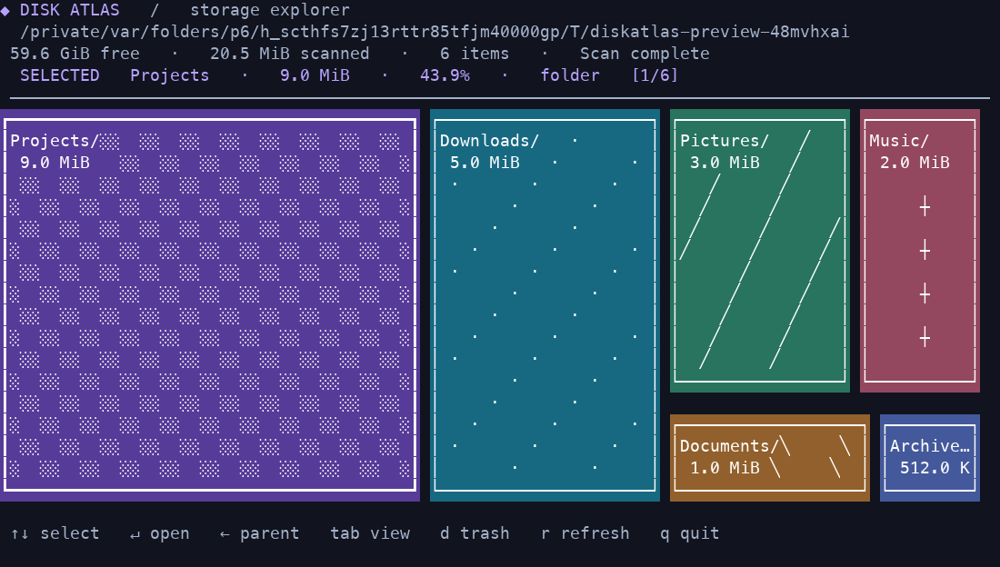

# Disk Atlas

A macOS terminal disk-usage browser with a colorful, patterned treemap. Explore folders, find large entries, and move unwanted folders to Trash with confirmation.



*Actual TUI output captured in a headless terminal using synthetic files.*

## Install

Requires macOS, Go 1.25.4 or newer, and a Unicode-capable terminal.

```sh
git clone https://github.com/Sarthakischauhan/diskatlas.git
cd diskatlas
make
./diskatlas
```

To install the command on your `PATH`:

```sh
mkdir -p "$HOME/.local/bin"
install -m 755 diskatlas "$HOME/.local/bin/diskatlas"
```

Ensure `~/.local/bin` is on your `PATH`. Without `make`, use `go build -o diskatlas .`.

## Use

```sh
diskatlas                       # home directory
diskatlas ~/Downloads           # a specific directory
diskatlas /System/Volumes/Data  # macOS data volume
```

| Key | Action |
| --- | --- |
| `↑` / `↓` or `k` / `j` | Select an entry |
| `Enter` / `→` | Open a folder |
| `Backspace` / `←` | Open the parent |
| `Tab` | Switch between treemap and list |
| `r` | Clear cached scans and rescan |
| `d` | Move the selected folder to Trash after confirmation |
| `Esc` | Cancel a scan or confirmation |
| `q` / `Ctrl-C` | Quit |

The map shows one directory level at a time. Completed scans are cached in memory for the current session and may become stale; press `r` to refresh. Disk Atlas asks Finder to move folders to Trash, so macOS may request Automation permission. A pending tile is hidden immediately and restored if the move fails.

Sizes are allocated blocks, not necessarily reclaimable space. Permissions, APFS clones and snapshots, shared blocks, and other volumes can make results incomplete or different from Finder and `df`. See the [user guide](docs/user-guide.md) for a walkthrough and troubleshooting.

## Development

```sh
make test    # go test ./... and go vet ./...
```

Disk Atlas is early-stage and has not been comprehensively tested across all Macs, terminals, or large filesystems.

## Security and license

Report vulnerabilities privately as described in [SECURITY.md](SECURITY.md). Licensed under the [MIT License](LICENSE).
