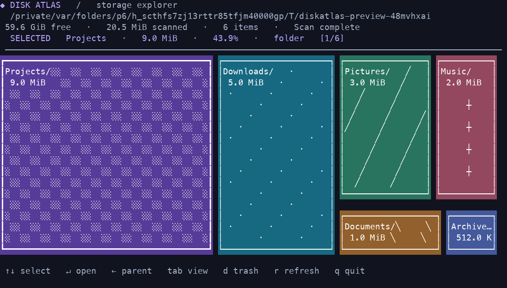
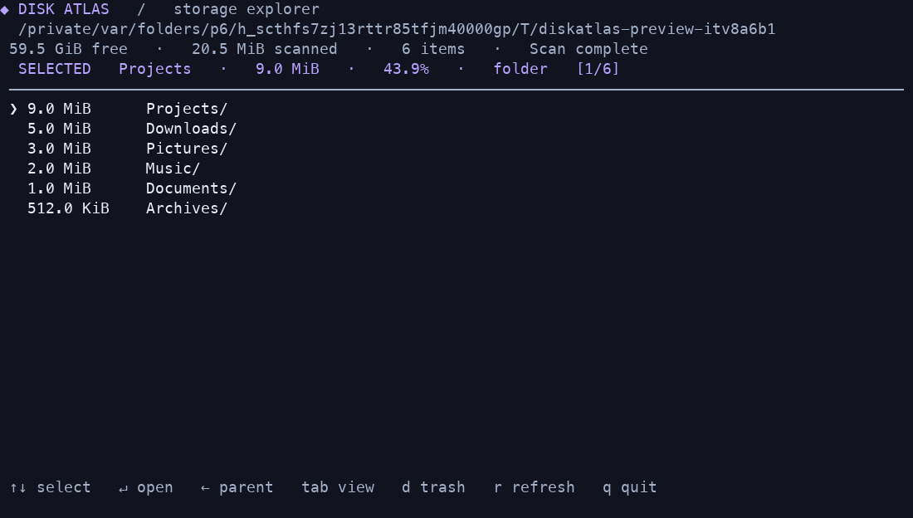

# Disk Atlas user guide

Disk Atlas helps you find large folders and files on your Mac. It is **read-only**: browsing and rescanning do not delete or change your files.

## 1. Start a scan

Open Terminal, Ghostty, iTerm2, or another terminal and run:

```sh
diskatlas
```

This scans your home directory. To scan a particular directory instead, pass its path:

```sh
diskatlas ~/Downloads
diskatlas ~/Library/Caches
diskatlas "/path/with spaces"
```

If you have built the app but haven't installed it on your `PATH`, run `./diskatlas` from the project directory. See [Install](../README.md#install) for setup.

The status line shows **Scanning** while the app walks the directory. The map appears when the scan finishes; large directories may take time. Press `Esc` to stop and see partial results, or `q` to quit. The status warns that a cancelled scan is incomplete.

## 2. Read the treemap



Each rectangle represents one file or folder directly inside the directory shown at the top. Its area approximates its share of the scanned entries' allocated space: larger tiles generally mean more space. Colors and patterns help distinguish tiles; they don't classify files. The heavier border marks the selected entry.

The selected line shows its name, size, percentage of scanned entries, type, and position in the size-sorted list. The free-space number is for the filesystem; it is not the amount occupied by the current directory.

## 3. Explore a folder

1. Press `↑` / `↓` or `k` / `j` to select an entry. Entries are ordered by size, largest first.
2. With a folder selected, press `Enter` or `→` to scan it. The map shows that folder's immediate children when scanning finishes.
3. Press `Backspace` or `←` to scan its parent. Navigation waits for the current scan to finish; use `Esc` first if you want to stop it.
4. Press `r` after a scan to scan the current directory again.

The map shows one directory level at a time, not nested folder contents simultaneously. If a file is selected, Enter does not open it.

## 4. Switch to the list



Press `Tab` to switch between the treemap and the size-sorted list. The list is useful for entries too small to label or display as individual tiles. Move through it with the same keys, and press `Tab` again to return to the map. `g` / `Home` selects the first entry; `G` / `End` selects the last.

## 5. Investigate safely

Disk Atlas cannot delete files. Once you've identified a candidate, exit with `q` and review it in Finder or your preferred tools before removing it. Application data, backups, and developer dependencies may be needed or recreated; don't delete a folder solely because it is large.

To look at the macOS data volume, you can run:

```sh
diskatlas /System/Volumes/Data
```

This can take a long time and may encounter protected directories. It does not include every volume or all APFS storage. For a quicker starting point, scan a specific folder such as `~/Downloads` or `~/Library/Caches`.

## Troubleshooting

- **`command not found`**: use `./diskatlas` from the build directory or install it to a directory on your `PATH` as described in the [README](../README.md#install).
- **Incomplete or inaccessible entries**: macOS may deny access to protected folders. If appropriate, grant your terminal Full Disk Access in System Settings → Privacy & Security, then rescan with `r`. Some system data can still be inaccessible.
- **The map takes a long time**: scan a smaller folder, or press `Esc` for partial results. Partial sizes are not a complete accounting.
- **Colors or characters look wrong**: use a Unicode-capable terminal and adjust its theme or color support. Transparency and blur are terminal settings; colored tile backgrounds are opaque.
- **Numbers differ from Finder or `df`**: Disk Atlas reports allocated blocks for accessible entries on the starting filesystem. APFS clones, snapshots, shared space, other volumes, and metadata can make totals differ; a folder's displayed size is not a guarantee of reclaimable space.

The app is early-stage and has not been comprehensively tested on every Mac, terminal, or large filesystem.
